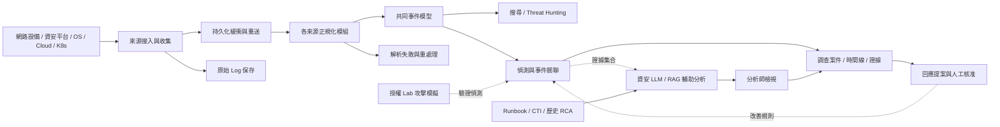

# Threat Hunting Lab

多來源網路、資安設備及軟體 Log 的收集、正規化、偵測、調查與回應架構。

**目前階段：架構與文件先行，部署環境待確認。** 本階段先定義模組邊界、資料流、來源 API、設定方式及驗收條件。真實設備串接、平台選型、資源配置與部署將在環境確認後安排。此專案為獨立研究框架，與 Coupang 或工具供應商無隸屬關係。

## 架構總覽



這是邏輯設計，不代表所有元件都已部署，也不要求每個模組都獨立成微服務。Kafka、ELK、Kubernetes、AWS 與各資安工具保留為候選技術，環境確認後再決定。

## 文件入口

| 文件 | 內容 |
| --- | --- |
| [文件索引與閱讀順序](docs/README.md) | 文件狀態、設計與 PoC 的區別 |
| [需求與範圍](docs/requirements.md) | 本期目標、功能需求、延後事項 |
| [系統架構](docs/architecture.md) | 分層、模組責任、資料流與邊界 |
| [來源接入設計](docs/source-ingestion.md) | 七類來源、IP 設定、獨立 API 與 Syslog 路由 |
| [API 與資料契約](docs/contracts.md) | HTTP 語義、共同模型、去重、版本與錯誤 |
| [AI 分析架構](docs/ai-analysis-architecture.md) | 偵測模型、資安 LLM、RAG 與五種 Agent 的接點 |
| [模型候選矩陣](docs/ai-model-candidates.md) | Hugging Face 研究候選、查核欄位與選型順序 |
| [AI 契約與評估](docs/ai-contracts-evaluation.md) | Evidence bundle、分析結果、評估指標與降級 |
| [環境確認表](docs/environment-checklist.md) | 設備、網段、流量、容量、權限與責任人 |
| [架構決策記錄](docs/decisions.md) | 已確認原則與待決策項目 |
| [工具整合矩陣](docs/integrations.md) | 工具責任、候選介面、目前完成程度 |
| [分階段計畫與驗收](docs/roadmap.md) | 文件完成後的環境確認與實作順序 |

## 現有程式定位

Repo 已有 v0.3 PoC，供後續參考：Python API、七種來源 endpoint、初版 normalizer、Syslog／檔案／CloudWatch collector、SQLite 暫存與示範案件流程。這些實作曾通過合成資料測試及 CI 容器收件檢查，**尚未完成使用者環境與實機相容性驗證**。

既有程式、測試與設定範例保留；目前不以「立即部署」作為下一步。需要查閱程式操作時請看 [PoC 參考手冊](docs/prototype-guide.md) 與 [PoC 環境變數接入方式](docs/environment-push.md)。部署與維運參數不能直接以 PoC 預設值定案。

## 專案結構

```text
docs/                  架構、需求、契約、環境確認與 PoC 參考文件
config/                Agent 職責與 collector 設定範例
dart_lab/              已建立的 PoC 程式
samples/               合成事件樣本
rules/                 示範規則範本
scripts/               PoC 初始化與測試資料工具
tests/                 PoC 行為與整合測試
compose.yaml           PoC 容器配置，非正式部署定案
```

下一步是依 [環境確認表](docs/environment-checklist.md) 盤點實際環境，再更新決策記錄與實作範圍。所有尚未知的值都保留為「待確認」，不預填真實 IP、帳戶或憑證。
