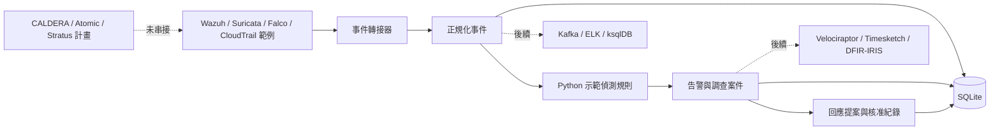

# Threat Hunting Lab

將 Attack → Detect → Investigate → Respond → Improve 架構做成可執行的 Python Lab。此專案為獨立練習框架，與 Coupang 或工具供應商無隸屬關係。

## v0.2 可以做什麼

- **多來源 Log 收集**：Syslog UDP／TCP／TLS、HTTP JSON／NDJSON／純文字、檔案續讀、AWS CloudWatch Logs 輪詢。
- 解析 RFC3164／RFC5424、CEF、JSON、key=value；未知格式保留原文，提供來源／主機過濾與 cursor 查詢。
- collector 具 SQLite outbox、HTTP 重試與檔案 checkpoint；提供 Fortinet、Palo Alto、Cisco、Windows／AD、Linux、AWS、Kubernetes 接入說明。
- 接收 Wazuh、Suricata、Falco、CloudTrail **範例格式**事件並正規化。
- 執行四條 Python 示範偵測規則，產生告警與本地調查案件。
- SQLite 持久化事件、告警、案件及回應提案；相同來源／內容重送時去重。
- 建立回應提案、記錄核准；不執行隔離主機、封鎖 IP 或停用帳號。
- 提供 OpenAPI 文件、三個主要 PoC 與 Kubernetes 額外範例、CI 測試。

**尚未完成：** Kafka／ELK 串流、各廠牌實機相容性驗證、完整供應商欄位解析、跨事件關聯、外部 DFIR 工具串接、LLM／MCP 執行、正式環境部署。`config/agents.yaml` 是五種 Agent 的介面規劃；`rules/sigma/` 是規則範本，Python 引擎尚未讀取 Sigma。

## 快速開始：Python

需要 Python 3.9+；新環境建議使用 3.12。

```bash
git clone https://github.com/chikai0712/Threat-hunting-lab.git
cd Threat-hunting-lab
python3 -m venv .venv
source .venv/bin/activate
python -m pip install --upgrade pip
python -m pip install -e '.[dev]'
export DART_API_TOKEN="$(python -c 'import secrets; print(secrets.token_urlsafe(32))')"
uvicorn dart_lab.api:app --host 127.0.0.1 --port 8000
```

開啟 <http://127.0.0.1:8000/docs>，在 **Authorize** 輸入剛才產生的 `DART_API_TOKEN`。所有資料 API 都需要 `X-API-Key`；`/health` 及 API 文件可直接讀取。

在另一個終端啟用相同 virtualenv，將 `DART_API_TOKEN` 設為啟動服務時使用的同一組值，再執行：

```bash
python scripts/demo.py
curl -H "X-API-Key: $DART_API_TOKEN" http://127.0.0.1:8000/cases
```

首次執行會產生 **4 筆事件、4 筆告警、4 筆案件**；再次執行相同資料不會增加案件。範例資料使用保留的文件用 IP、虛構主機及 AWS 帳號，沒有真實入侵或攻擊命令。

## 接入各類設備與軟體 Log

安裝完成後，先依上方方式啟動 API。在另一個終端設定相同 token，即可啟動收集器：

```bash
threat-log-collector --source network-lab --spool data/network-outbox.db syslog
```

預設收集 `127.0.0.1:5514` 的 UDP／TCP Syslog。再開終端執行 `python scripts/send_syslog.py`，會送出 6 筆合成設備 Log，可在 `/docs` 的 `GET /logs` 查詢。

**完整接入方式：[多來源 Log 收集指南](docs/log-collection.md)**，包含七類來源設定、TLS、來源 CIDR、HTTP／Fluent Bit 範例與 AWS IAM／CloudWatch 前提。collector 可直接在 Python 環境啟動；現有 Compose 仍只啟動 API。

## Docker Compose

```bash
cp .env.example .env
# 將 .env 內的 DART_API_TOKEN 設為至少 24 字元的隨機值
# 可用：python3 -c 'import secrets; print(secrets.token_urlsafe(32))'
docker compose up --build -d
```

API 僅綁定本機 `127.0.0.1:8000`，資料保存在 `dart-data` volume。Compose 只啟動本專案 API，不會安裝 Wazuh、Kafka 或其他外部工具。若要從主機執行 demo，請先設定與 `.env` 相同的環境變數；Python 啟動模式不會自動載入 `.env`。

## 架構



## 專案目錄

```text
dart_lab/           API、資料模型、轉接器、規則及 SQLite 儲存
samples/            合成事件：Endpoint / Network / AWS / Container
scripts/demo.py     重播四組事件
rules/sigma/        Sigma 規則範本（尚未接入執行引擎）
config/agents.yaml  五種 Agent 職責與工具邊界（設計）
config/collectors/ Fluent Bit / rsyslog 設定範例
docs/               架構、整合契約、PoC、後續計畫
tests/             行為與 API 測試
```

## API 與回應流程

| Endpoint | 功能 |
| --- | --- |
| `POST /logs`、`GET /logs` | 通用 Log 批次匯入與 cursor 查詢 |
| `POST /collect/{source}` | Agent HTTP JSON / NDJSON / text 匯入 |
| `POST /ingest` | `{source, payload}` 供應商範例格式 |
| `POST /events` | 直接送入正規化事件 |
| `GET /events`、`/alerts`、`/cases` | 最近資料；`limit` 預設 100、上限 1000 |
| `GET /cases/{id}` | 案件與初始事件時間線 |
| `GET /coverage` | 已實作規則與 ATT&CK 標籤清單 |
| `POST /cases/{id}/responses` | 建立回應提案 |
| `GET /responses` | 回應提案與核准狀態 |
| `POST /responses/{id}/approve` | 記錄人工核准；沒有執行 API |

`/coverage` **不是經測量的偵測覆蓋率**。泛用 Suricata 告警不會一律標註為 C2。MITRE 標籤僅是調查分類提示，不代表已確認攻擊。

回應提案範例：

```json
{
  "action": "collect_evidence",
  "target": "lab-endpoint-01",
  "rationale": "確認異常登入的來源與時間線"
}
```

核准 body：`{"reviewer":"lab-analyst","note":"限隔離 Lab，記錄核准"}`。本版共用 API key，reviewer 為自述欄位，**不提供身分驗證或雙人覆核**；核准紀錄只是 Lab 工作流程，不應作為正式控制措施。

## 開發驗證

```bash
python -m pip install -e '.[dev]'
ruff check .
pytest -q
```

GitHub Actions 會在 Python 3.9／3.12 跑測試、檢查 Compose，並另外建置容器。依賴版本固定於 `pyproject.toml`；尚未提供包含所有間接依賴的 lockfile。

深入說明：[架構](docs/architecture.md) · [工具整合契約](docs/integrations.md) · [PoC 步驟](docs/poc.md) · [Roadmap](docs/roadmap.md) · [安全與資料邊界](SECURITY.md)
