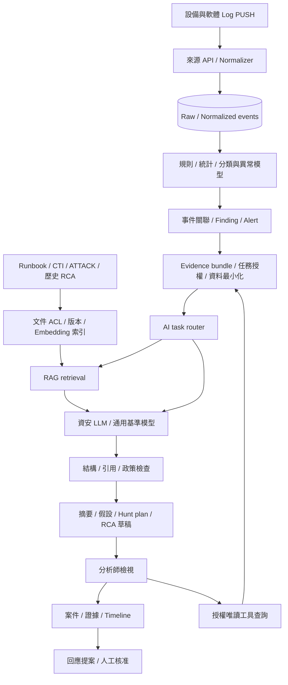

# AI 資安分析與 Hugging Face 模型整合

狀態：設計草案，沿用架構先行範圍。此文件將使用者提供的模型研究筆記納入平台設計；本輪不下載權重、不呼叫推論服務、不新增可執行AI endpoint。

## 與既有系統的接點

AI分析從 [共同事件模型](contracts.md)、已關聯的告警／案件與可追溯證據開始。來源正規化仍由版本化parser負責，原始Log仍保留；模型不能改寫原始證據或把假設變成已確認事件。

圖為目標設計。現有PoC只有來源接入、示範規則與本地案件；router、evidence bundle、RAG、模型服務及輸出驗證均待實作。

## 三層職責

| 層 | 處理單位 | 工作 | 產物／界線 |
| --- | --- | --- | --- |
| Detection | 事件／時間窗／序列 | 規則、統計基準、小型分類、異常分數 | Finding與特徵reference；異常不等於入侵 |
| Reasoning | 限定大小的證據集合與任務 | 告警摘要、調查假設、ATT&CK候選、RCA／回應草稿 | 含證據引用與未知項的建議；不作自動裁決 |
| Knowledge Retrieval | 有權限的文件片段 | Runbook、CTI、歷史案例與技術知識查詢 | 含文件版本、chunk ID與有效時間的檢索結果 |

不要讓每筆高流量Log直接觸發LLM。先由規則／統計與關聯篩選，再按案件、分析師請求或受控背景任務觸發；輸入事件上限、時間窗、併發與成本預算由環境盤點決定。

## 模組責任

| 模組 | 輸入 → 輸出 | 重要設計 |
| --- | --- | --- |
| Model registry | 候選／評估結果 → 核准的模型設定 | 精確repo、revision、tokenizer、license、量化與用途 |
| Feature／anomaly adapter | 事件序列 → score／finding | 依來源版本建特徵與基準，不把跨資料集結果直接套用 |
| Evidence builder | case與查詢結果 → evidence bundle | event/raw references、查詢範圍、時間、缺漏與截斷紀錄 |
| Task router | task type／權限 → inference adapter | 依任務能力選模型，設定timeout與配額 |
| Retrieval service | 問題／ACL／時間範圍 → 引用片段 | 檢索前限制權限，回傳前再驗證；防止跨案件洩漏 |
| Inference adapter | 版本化prompt與context → structured output | 生成／embedding／分類介面分離，不假設都支援chat或tools |
| Output validator | 模型輸出 → 可顯示草稿或拒絕結果 | schema、引用存在性、權限、證據支持度與action policy |
| Analysis store | task input hash／結果 → audit reference | 保存版本、延遲、檢索來源與分析師判定，依政策遮罩 |

Hugging Face在此主要是模型／tokenizer與模型卡的候選來源，不等同部署runtime。Transformers、自架推論server或受管endpoint如何選擇，需先確認模型架構支援、GPU與資料外送要求；不預設所有模型可用同一服務協定。

## 五種 Agent 如何使用模型

| 角色 | AI能力 | 工具邊界 |
| --- | --- | --- |
| Detection | 告警分類與規則建議；異常模型提供finding | 查詢事件與規則，規則發布需另行驗證 |
| Threat Hunting | CTI／ATT&CK解析、hunt hypothesis與查詢草稿 | 唯讀SIEM／Zeek／情資；查詢需限時窗、範圍與成本 |
| Investigation | 證據摘要、時間線解釋、RCA假設 | 查詢已取得證據；新蒐證collection是另一項需授權的工作 |
| Response | 遏止方案、影響與回復步驟草稿 | 不直接封鎖、隔離或停用帳號；交給既有核准流程 |
| Purple Team | 授權範圍內的測試計畫與預期告警 | 只產生計畫；執行由獨立工具政策與Lab授權處理 |

[角色設定檔](../config/agents.yaml)是設計契約，沒有runtime讀取。模型若不支援可靠tool calling，仍可用結構化建議配合確定性程式處理；不讓模型自行擴大工具權限。

## RAG 資料流程

知識文件登錄 → 權限／資料分級 → 版本與有效日期 → 去識別化／分段 → embedding → 索引 → 權限內檢索 → 引用驗證。Runbook、CTI與歷史案件分開標示來源可靠度與時間；已撤銷文件須同步移除或失效索引，embedding快取也受權限及retention限制。

Embedding模型、維度、tokenizer、分段方式與索引版本一同記錄。切換模型或維度需要重建索引，不混用不同向量空間。向量資料庫、keyword/hybrid search與reranker均為待選項；BGE-M3只是候選之一。

## 失敗與降級

模型不可用、timeout、資源不足、格式不符或引用無法驗證時，保留案件與原有規則結果，分析任務標記failed／needs_review，不阻塞Log收集。無證據或檢索不到內容時回傳insufficient_evidence，不補造結論。Fallback只能切換至已評估、且允許相同資料處理範圍的模型，不自動轉送外部服務。

Log／CTI／檢索文件皆是不可信文字；輸入資料與系統任務分隔，內容中的指令不能授權工具。引用ID存在不代表推論成立，需另外評估claim是否受證據支持。模型自述confidence不當作校準機率或事件升級門檻。

選型見 [模型候選矩陣](ai-model-candidates.md)，介面與驗收見 [AI契約與評估](ai-contracts-evaluation.md)。
