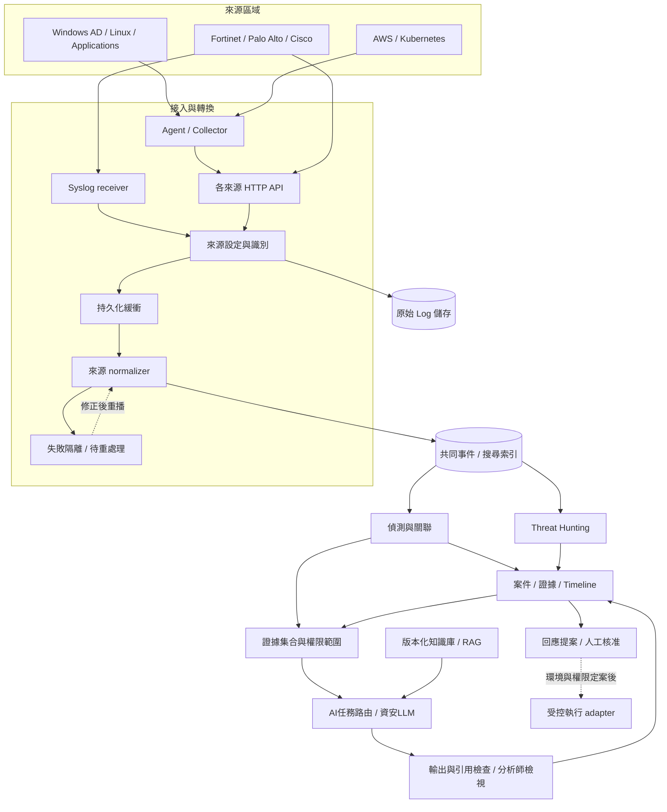
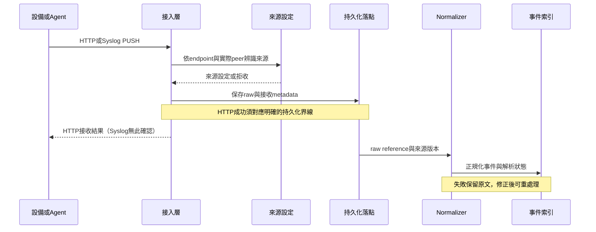

# 系統架構

狀態：邏輯架構草案。部署拓撲、產品版本、資源容量與正式服務位址待確認。邏輯模組可以先在同一程序實現，再依負載及責任邊界拆分。

## 分層與責任

| 層 | 模組 | 輸入 → 輸出 | 主要責任 |
| --- | --- | --- | --- |
| 來源層 | 網路／資安設備、OS、軟體、Cloud、K8s | 原始事件 → 協定輸出 | 啟用來源 logging、時間同步與送出策略 |
| 接入層 | HTTP API、Syslog receiver、agent／collector | PUSH／必要時 PULL → Raw envelope | 協定終結、來源識別、大小限制與接收結果 |
| 緩衝層 | 持久化佇列／outbox | Raw envelope → 待解析事件 | 承受短暫離線、重試、背壓與失敗隔離 |
| 轉換層 | Source registry、來源 normalizer | Raw → Normalized／解析失敗 | 版本化欄位映射、時間與型別檢查 |
| 資料層 | Raw store、Event index、Case store | 原文／事件／案件 → 可查詢資料 | 保存週期、參照、索引與存取控制 |
| 分析層 | 搜尋、Sigma／規則、關聯引擎 | Event → Finding／Alert | 查詢、時間窗關聯、命中證據與規則版本 |
| 調查層 | 案件、證據、時間線 | Alert／證據 reference → 調查結果 | 案件生命週期、證據追溯、RCA |
| 回應層 | 提案、核准、受控執行 adapter | 調查結果 → 提案／稽核 | 角色授權、執行前提、回復計畫 |
| 改善層 | Purple Team、規則改善 | 授權測試結果 → 覆蓋缺口 | 測試 run 追蹤與實測偵測品質 |

## 系統資料流

來源 raw reference、source ID、normalizer version 必須隨事件向下傳遞。圖中的 Raw store 與緩衝層可由同一持久化落點起步；正式拆分後需先定義 durability boundary，避免「已回覆成功但尚未保存」的空窗。

## 一筆 PUSH 的處理順序

目標架構可採非同步流程；現有 PoC HTTP 為同步 transaction，保存 raw 與 event 後回 200。未來若拆出 broker，不可沿用回應形式卻悄悄改變成功語義，需依 [契約](contracts.md) 版本化。

## Source registry 與設定面

環境變數先表達允許的來源與 receiver 位址；registry 將 source profile、IP／CIDR、協定、normalizer version、metadata 與權限政策串起來。來源種類與實體設備識別應分開：`fortinet` 是 profile，實際設備另以 device_id 表示；多台同廠牌不能只靠 profile 名稱當作唯一設備。

HTTP 可依 endpoint 區分 profile；Syslog 本身不帶 URL，必須透過可信的來源位址、獨立 listener 或經驗證的 forwarder metadata 選擇 profile。NAT／集中 relay 的條件由 [接入設計](source-ingestion.md) 說明。

## 資料與控制邊界

原始 Log、搜尋事件、案件與稽核資料各有不同保存週期與權限。來源傳來的 host／user／文字為資料，不等同可信身分。PoC 的 IP-only PUSH 與共用 key 是展示機制；正式認證、TLS 終結、代理信任與角色制度需在環境設計中選定。

資料面處理收集、解析與搜尋；設定面處理來源設定、規則版本、權限與保存政策。設定變更應可追溯且可回復；目前 PoC 為重啟載入，動態設定尚未實作。

## 候選部署形態

| 選項 | 適用前提 | 需要先確認 |
| --- | --- | --- |
| 單機 Lab | 少量合成／測試事件、允許停機 | 可用 OS、磁碟、port、來源 IP 可見性 |
| 集中式 VM／主機 | 單一或少數站點、已有維運工具 | 網路分區、持久化、備份、容量與可用性 |
| 分散式 collector + 中央平台 | 多站點、網段隔離或高流量 | 站點網路、斷線緩衝、中央 broker／index、跨站管理 |
| Kubernetes／雲端 | 團隊已有該平台及治理能力 | ingress／egress、持久化、secret、IAM、費用與運維 |

目前不指定最終選項。Kafka、Elasticsearch／Kibana、ksqlDB 等都是候選元件；既有 SIEM／訊息平台可先納入整合，避免重複儲存與收集。

## AI／MCP 與工具整合

五種角色沿用 [Agent 職責範例](../config/agents.yaml)：Detection、Threat Hunting、Investigation、Response、Purple Team。先定義輸入、工具權限與可引用證據；LLM／MCP provider、憑證、資料外送與執行 policy 尚待確認。回應執行權由獨立政策與身分層決定，不由日誌內容或模型輸出授權。

工具選項與完成程度見 [整合矩陣](integrations.md)。現有程式差距見 [PoC 實作架構](prototype-architecture.md)，後續順序見 [Roadmap](roadmap.md)。

## 資安模型與RAG的擴充設計

AI模組拆為Detection（規則／統計／分類與異常）、Reasoning（案件證據分析）與Knowledge Retrieval（有權限的Runbook／CTI／歷史RCA檢索）。生成模型位於關聯與證據整理之後，不取代來源normalizer；模型離線不阻塞收件或既有規則偵測。

候選包含使用者提供的Foundation-Sec系列、MiST、CyberPal、SecBERT、LAnoBERT、BGE-M3及通用模型baseline，皆待核實精確repo與選型。完整資料流見 [AI分析架構](ai-analysis-architecture.md)，分析輸入／輸出及降級見 [AI契約與評估](ai-contracts-evaluation.md)。
