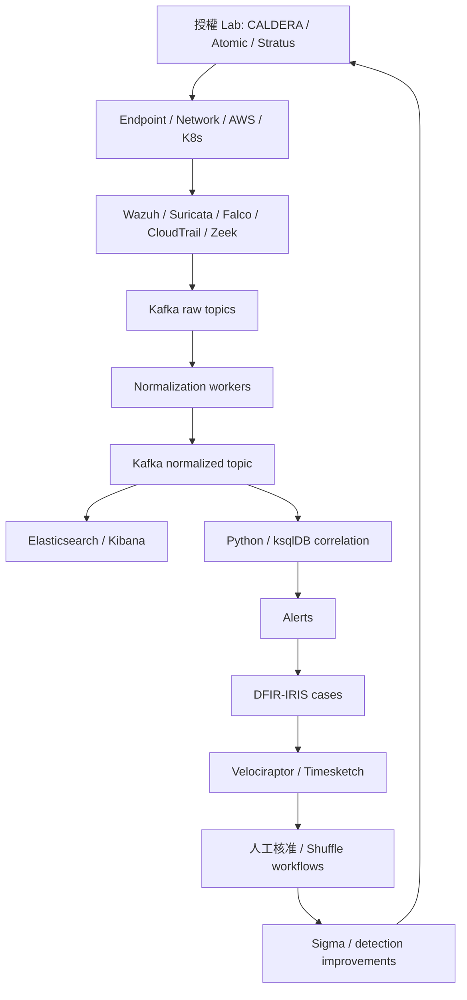

# 架構與資料流

## 目前實作

單一 FastAPI process + SQLite 適合本機展示與小量事件。API key 在啟動時讀取；token 少於 24 字元會阻止啟動。事件、規則命中及案件建立於同一筆資料庫 transaction，避免部分寫入。每條命中規則建立一個獨立案件，尚未實作跨告警合併。

`/ingest` 以 source + canonical JSON 的 SHA-256 當作事件 ID；同來源且內容相同會去重，但供應商多送一個欄位便視為另一事件。`/events` 則由呼叫端提供全域唯一 event_id；重複 ID 會忽略後送的內容。timestamp 必須含時區。SQLite 單寫入者是 Lab 的容量限制。

### 正規化事件

| 欄位 | 用途 |
| --- | --- |
| event_id | 去重 ID |
| timestamp | 含時區的原始事件時間 |
| source | wazuh / suricata / falco / cloudtrail |
| host、actor | 可選的主機或操作主體 |
| action | 描述或 API 操作 |
| severity | info / low / medium / high / critical |
| details | 原始 payload，可能包含敏感資訊 |

案件時間線目前只含觸發事件；後續證據收集與 RCA 需由分析者處理。回應狀態為 `pending_approval → approved`，核准後仍為 `execution_enabled=false`。未實作執行器或任何對外工具呼叫。

## 目標架構（尚未部署）

Kafka 建議規劃 `dart.raw.<source>`、`dart.events.v1`、`dart.alerts.v1`、`dart.dead-letter.v1`。consumer 成功寫入後才能提交 offset；以 event_id 做冪等寫入，失敗 payload 送 DLQ 並附錯誤原因與 schema 版本。此為待實作契約，現有 API 不會送 Kafka。

ELK 建議依 ECS 建立正式 mapping；現在的簡化 Event **不是完整 ECS**。生產前需定義 schema migration、retention／ILM、個資遮罩、source timestamp 與 ingest timestamp、重送與 backfill 策略。

## AI + MCP 邊界

五種角色見 `config/agents.yaml`。此檔沒有執行程式讀取，也不會觸發模型或工具。後續 MCP adapter 應具備工具 allowlist、讀寫權限隔離、來源證據引用及 audit trail。來自日誌、情資及工具回傳的文字都視為不可信資料，不能授權工具執行。回應執行需在身分驗證與政策層獨立實作，不能依賴 prompt 或本版自述 reviewer 欄位。
