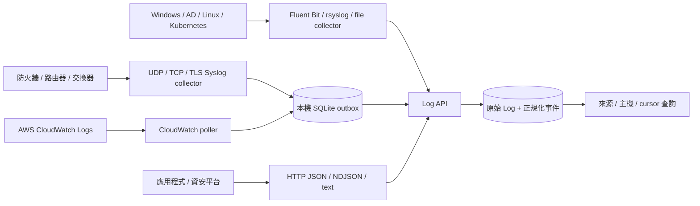

# 多來源 Log 收集

v0.2 提供可執行的通用收集入口。支援不代表每個品牌、韌體、事件類型的欄位解析都已驗證；目前測試使用合成資料與模擬 CloudWatch API，尚未連線至實體設備或雲端帳戶。

## 接入矩陣

| 來源 | 接法 | 目前解析／保存能力 |
| --- | --- | --- |
| Fortinet FortiGate | Syslog UDP／TCP，設備支援時可用 TLS | Syslog、常見 key=value；其他格式保留原文 |
| Palo Alto PAN-OS | Syslog Server Profile + Log Forwarding Profile | Syslog envelope；預設 CSV 保留原文，CEF 自訂格式可解析 |
| Cisco switch/router/firewall | Remote Syslog | RFC3164／RFC5424；廠商特有 prefix 保留原文 |
| Windows／AD | Fluent Bit winlog → HTTP | Security／System／Application 事件 JSON，保留所有欄位 |
| Linux | rsyslog → Syslog，或本機檔案 collector | Syslog、JSON、key=value、純文字 |
| AWS | CloudWatch Logs 輪詢 collector → HTTP | 原始 message + AWS event ID／log group／stream／時間欄位 |
| Kubernetes | 節點 Fluent Bit tail → HTTP | container CRI／Docker parser 輸出 JSON；可另送 Falco |
| WAF／IDS／IPS／EDR／VPN／Proxy／NAS／DB／Web／應用程式 | 任一支援的 Syslog、HTTP 或檔案出口 | CEF、JSON、key=value，未知格式與 LEEF／CSV 先保留原文 |

不會自動登入設備、開啟 Log 匯出、讀取 Windows EVTX 二進位檔、收 SNMP Trap／NetFlow，或直接拉取任意廠商 API。需在來源設備設定轉送，或在可讀取資料的主機部署 collector／agent。



圖中的 outbox 為本專案 collector 所用；Fluent Bit 與 rsyslog 有自己的佇列設定。

## 啟動 API

依 README 安裝專案並啟動 API。以下 collector 指令需啟用相同 virtualenv、使用 API 相同的 `DART_API_TOKEN`。

```bash
export DART_API_URL=http://127.0.0.1:8000
# DART_API_TOKEN 必須與 API 相同；不要把實際 token 提交到 Git。
```

## Syslog 收集器

```bash
threat-log-collector --source network-lab --spool data/network-outbox.db syslog
```

預設僅接收 `127.0.0.1:5514` 的 TCP／UDP，允許來源為 loopback。支援 TCP newline framing 與 RFC6587 octet counting；同一 frame 可跨多次 TCP 傳輸。每 frame 上限 65,536 bytes，TCP 閒置 30 秒會斷線，最多 32 個活躍 TCP connection。

接實體設備時，使用收集主機的管理網 IP 和實際設備 CIDR（下列為文件用位址，請替換）：

```bash
threat-log-collector --source fortigate-site-a --vendor Fortinet --product FortiGate \
  --asset-type security --spool data/fortigate-outbox.db \
  syslog --bind 192.0.2.10 --port 5514 --allowed-cidrs 192.0.2.20/32
```

同一 listener 會標示相同 source/vendor/product；混用多品牌時，使用 `--source network-mixed` 並省略 vendor/product，以 sender host／peer 區分。需要確切設備分類時，為不同來源開不同 port、獨立 process 及 spool。

TLS 模式（需要自備憑證與設備端 CA 信任設定）：

```bash
threat-log-collector --source syslog-tls --spool data/tls-outbox.db \
  syslog --bind 192.0.2.10 --port 6514 --allowed-cidrs 192.0.2.0/24 \
  --tls-cert /path/to/server.crt --tls-key /path/to/server.key --no-udp
```

此為伺服器 TLS + CIDR allowlist，未實作 client certificate／mTLS。未加 `--no-udp` 時，即使 TCP 啟用 TLS，UDP 仍為明文。

可用本機合成資料測試：

```bash
python scripts/send_syslog.py
```

### Fortinet

在 FortiOS 設定 Syslog server 為 collector IP／port、所需 log 類別與 severity。一般可選 UDP 或可靠 TCP；不同版本命令、TLS 與 framing 行為不同，請按設備版本確認。傳統格式常見 `date=... time=... devname=...`，有些版本只有 `<PRI>` 前綴；collector 支援此類 key=value payload。請在設備端同時啟用 policy traffic logging，僅設定目的地不會產生所有流量日誌。

### Palo Alto

建立 **Device → Server Profiles → Syslog**，設定 collector IP、port、transport；在 **Objects → Log Forwarding** 設定要送出的 Traffic／Threat 等類型，並將 Profile 套用到規則。System／Config 類型依版本於 Log Settings 設定。預設 PAN-OS CSV 欄位會隨版本變動，本版保存完整 CSV，不宣稱已對每欄正規化。若輸出合法 CEF，可使用通用 CEF parser。

### Cisco

在設備設定 remote logging host、port 與 severity。多數 IOS／IOS-XE 可選 Syslog UDP，部分型號支援 TCP／TLS；請依實際作業系統確認命令。建議開啟 hostname、timestamps 與 NTP。若輸出含特殊 sequence／Cisco timestamp prefix，仍會保存原文，parser_status 可能是 error，後續可依樣本新增 parser。

## Windows／AD

在 Windows 主機安裝 Fluent Bit，使用 [winlog 設定](../config/collectors/fluent-bit-windows.conf)，修改 Host／Port 與 URI。設定程序環境變數 `DART_API_TOKEN`，使用可讀 Security Event Log 的服務帳號執行。AD 網域控制站可依需要加入 `Directory Service`、`DNS Server`；Sysmon 安裝後才加入對應 channel。

```powershell
fluent-bit.exe -c config/collectors/fluent-bit-windows.conf
```

此為 agent 在 Windows 讀取 Event Log 後送 JSON；不會從此 Python 程式遠端讀取任意 Windows 主機。第一次部署前決定是否重播舊事件；winlog 的 DB 檔須保存於可寫入的持久路徑。

## Linux／應用程式檔案

```bash
threat-log-collector --source linux-auth --asset-type server \
  --spool data/linux-outbox.db file /var/log/auth.log --follow

# 不加 --follow：讀到檔案尾端並將待送資料送出後結束。
threat-log-collector --source nginx --asset-type application \
  --spool data/nginx-outbox.db file /var/log/nginx/access.log
```

每次最多讀 500 行，再讓 forwarding 執行。offset 與入佇列同一 transaction；重新啟動不會從頭重讀。follow 模式等待完整換行後才入列，可辨識 inode 更換與檔案縮小。沒有掃描全部 rotated files，無法保證捕捉輪替瞬間舊 inode 的未讀尾端，也無法可靠辨識快速 copytruncate 後再次長大的檔案；高流量正式環境應使用成熟 agent。單行超過 64 KiB 會讓 file collector 結束並保留先前 checkpoint，需先處理格式後重啟。

或用 [rsyslog 範例](../config/collectors/rsyslog.conf) 將已進入 rsyslog 的訊息送出；先替換目的地並驗證設定，再套用到來源主機。

## AWS CloudWatch Logs

```bash
python -m pip install -e '.[aws]'
threat-log-collector --source aws-lab-account --asset-type cloud \
  --vendor AWS --spool data/aws-outbox.db cloudwatch \
  --region ap-northeast-1 --log-group /aws/lambda/example \
  --log-group /aws/eks/example/cluster
```

使用 boto3 標準 credential chain（role、profile、環境設定），不將 AWS 憑證放入 repo。執行身份需對指定 log groups 有 `logs:FilterLogEvents` 權限；此功能不會替你建立 IAM role 或開啟來源服務 logging。

預設首次回看 60 分鐘，每 30 秒輪詢，重疊回讀 300 秒；由 AWS event ID 去重。每頁先寫入 outbox，所有頁完成後才更新 cursor。單次 poll 失敗會保留 cursor，等待重試。事件延遲超過 overlap window 可能遺漏；需視來源調整 `--overlap-seconds` 或重新匯入。不同 AWS 帳戶請使用不同 source／spool。

CloudTrail、VPC Flow Logs、WAF、EKS 等須先設定發送至 CloudWatch Logs。僅存在 S3 的 CloudTrail 檔案不會自動被此 collector 掃描。CloudWatch metadata 位於 `attributes`，原始 message 位於 `raw`；泛用紀錄的頂層 timestamp 若無可解析時間仍使用接收時間，AWS 原始時間保存在 `attributes.timestamp_ms`。

## Kubernetes

將 [Fluent Bit 設定](../config/collectors/fluent-bit-kubernetes.conf) 合併到現有 DaemonSet／Helm 部署。需只讀掛載 `/var/log`，保存 tail DB／buffer，並以 Secret 注入 `DART_API_TOKEN`。範例 host `threat-lab-api` 為待替換的叢集 Service 名稱；請提供可達的 API 位址。

此設定收集 `/var/log/containers/*.log` 的 CRI／Docker 日誌；不會自動開啟 Kubernetes audit log 或 Falco。EKS control plane audit log 可走上述 CloudWatch collector。metadata enrichment、RBAC 與 Helm 部署仍需依叢集配置；此版未實際部署到 Kubernetes。

## HTTP：任意軟體／平台

- `POST /logs`：完整 metadata，`{"records":[{"source":"waf","raw":"...","format":"auto"}]}`，每批 1–200 筆。
- `POST /collect/{source}`：agent-friendly 入口；`application/json` 接物件／物件陣列；NDJSON／text 則逐行處理，每批 1–5000 筆。
- 兩者皆需 `X-API-Key`。每 HTTP body 上限 2 MiB，每 raw 最多 65,536 個字元。Fluent Bit chunk 若超過上限會被拒收；依事件大小與流量調整 flush／batch，並監控 4xx 及 retry backlog。
- `/collect` 可用 `format`、`host`、`vendor`、`product`、`asset_type` query parameters。

```bash
curl -X POST "$DART_API_URL/collect/custom-app?asset_type=application" \
  -H "X-API-Key: $DART_API_TOKEN" -H 'Content-Type: application/json' \
  -d '{"message":"service started","hostname":"app-01","level":"info"}'

curl -H "X-API-Key: $DART_API_TOKEN" \
  "$DART_API_URL/logs?source=custom-app&limit=100"
```

回應的 `next_cursor` 可帶入下次 `after`，依接收順序前進；可同時用 source／host 精確過濾。`has_more` 表示該查詢還有後續資料。

## 可靠性與資料語義

- `/logs` 的 record_id 是可選；有 ID 時以 `(source, record_id)` 去重，相同 ID 卻不同內容回 409，整批 rollback。無 ID 時相同文字也視為不同事件，避免吞掉重複發生的行為。
- `/collect` 可送 `Idempotency-Key` 去除整批重試；未送則視為新紀錄。Fluent Bit 範例沒有動態 idempotency key，因此重試可能重複，需下游關聯去重。
- collector 每筆建立穩定 ID，HTTP 確認完整批次成功後才刪除 outbox。API 中斷或 4xx 時資料留在 outbox，等待修復；永久格式問題會阻擋該批次，需查詢錯誤與維運處理。
- UDP 沒有交付保證。TCP 傳輸確認不是 durable-storage acknowledgement；本版不實作 RELP。高可靠性來源應使用 agent 持久化 buffer／HTTP acknowledgement。
- collector 保存 `raw_base64` 以保留接收到的原始 bytes；`raw` 以指定 encoding 解碼，無法解碼字元用 replacement character。HTTP `/logs` 原樣保存 raw 字串；`/collect application/json` 保留物件語義但會重新序列化，不保證原始空白／欄位排列。
- Syslog timestamp／hostname 是設備自述值；`peer` 是 collector 看到的網路來源，可能經 NAT。HTTP metadata 由已持有共用 key 的呼叫者提供，不是設備身分驗證。
- RFC3164 缺少年份／時區，本版保存原時間字串並採接收時間，不擅自推定年份。RFC5424 支援含時區的 ISO8601。
- 未知格式存為 unparsed，解析錯誤存為 error；原文都可查。通用收集目前不自動套用四條專用示範偵測規則；原 `/ingest` 路徑持續可用。
- SQLite 與 outbox 尚無 retention／容量警戒／自動清理；需管理磁碟與資料敏感度。多來源高流量正式部署下一階段採 Kafka + Elasticsearch，現在仍是 Lab。
